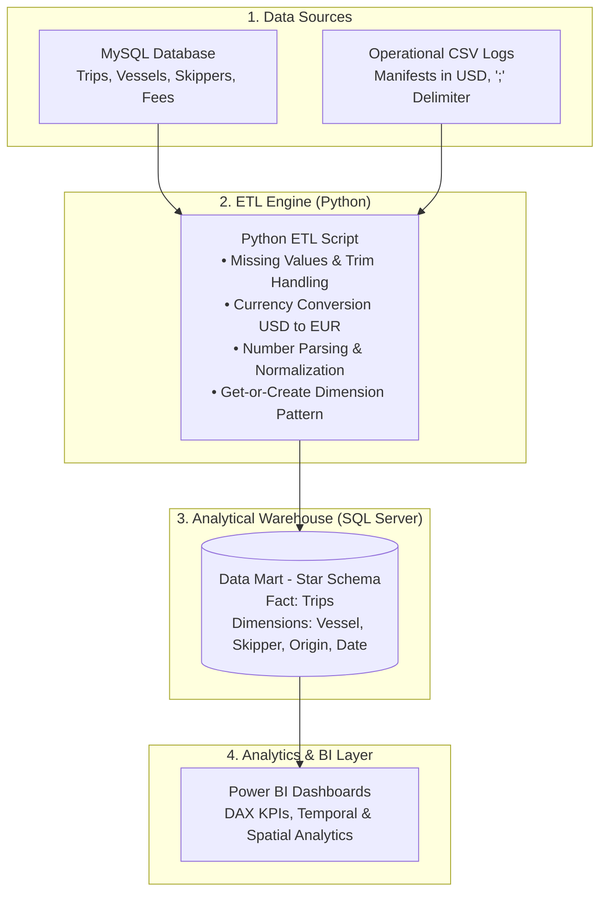
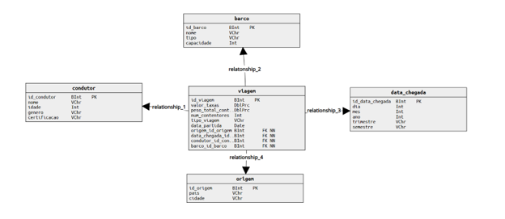
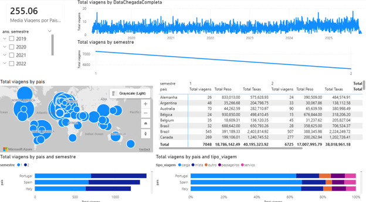
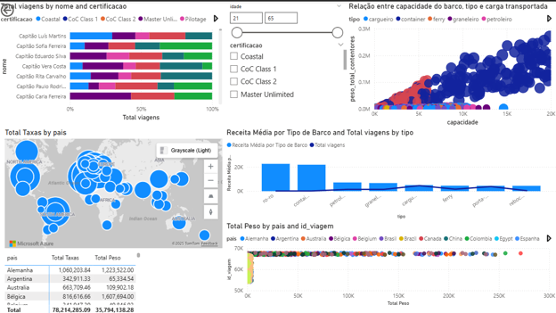

# 🚢 Port Logistics & Maritime Traffic BI Pipeline
> **End-to-End Data Pipeline:** Heterogeneous Data Ingestion $\rightarrow$ Python ETL $\rightarrow$ SQL Server Data Mart (Star Schema) $\rightarrow$ Decision-Support Dashboards in Power BI.

---

## 📌 Project Overview
This project delivers a complete Business Intelligence and Data Warehousing solution designed to monitor, analyze, and optimize commercial vessel traffic and operations at the **Port of Figueira da Foz**.

The core objective was to consolidate dispersed operational logs, standardize heterogeneous data formats and business metrics, and build executive reports to support strategic decision-making regarding:
- **Port fees and revenue generation;**
- **Cargo traffic and volumetric efficiency (TEU capacity vs. transported cargo weight);**
- **Seasonality patterns and geographic origins of maritime routes;**
- **Crew demographics and operational certifications.**

---

## 🏗 System Architecture



---

## 🔄 ETL Pipeline & Business Logic Implementation

The automated pipeline (`etl/etl_pipeline.py`) ensures data quality, consistency, and referential integrity through the following stages:

1. **Heterogeneous Ingestion:**
   - Extracts transactional records via relational SQL queries against the operational **MySQL** database.
   - Parses operational cargo manifest logs from **CSV** files.
2. **Transformation & Cleansing:**
   - **Handling Missing Values:** Replaces empty geographic entries with standard fallbacks (e.g., `DESCONHECIDO`) to prevent broken joins.
   - **Currency Normalization:** Converts fees billed in US Dollars (`USD`) to Euros (`EUR`) using a fixed exchange rate.
   - **Number Parsing:** Cleans up decimal commas and thousand-separator dots, casting raw strings into proper `float` and `int` datatypes.
   - **Feature Engineering:** Derives analytical calendar dimensions (quarters, semesters) and estimates vessel hull length based on TEU capacity thresholds.
3. **Data Mart Loading:**
   - Implements a *Get-or-Create* lookup pattern with surrogate keys, verifying existing dimension records prior to populating the fact table to eliminate duplicates and preserve relational constraints.

---

## 📊 Dimensional Modeling (Star Schema)

The Data Mart was modeled following dimensional modeling principles (Star Schema) to optimize analytical queries:



- **Fact Table (`viagem`):** Captures individual completed voyages along with core measures (`valor_taxas`, `peso_total_contentores`, and `num_contentores`).
- **Dimension Tables:**
  - `barco`: Vessel name, category, TEU capacity, and length.
  - `condutor`: Skipper profile, age, and maritime certification level.
  - `origem`: Departure port/city and country of origin.
  - `data_chegada`: Date hierarchy containing day, month, year, quarter, and semester attributes.

---

## 📈 Executive Dashboards (Power BI)

### Dashboard 1: Temporal Trends & Geographic Distribution

- **Temporal Inflow:** Daily and semester-based trip volumes tracking operational seasonality.
- **Geographic Origins:** Global origin mapping broken down by total trips and revenue contribution by country.
- **Cargo Segmentation:** Voyage activity decomposed by cargo category (Cargo, Mixed, Passenger).

### Dashboard 2: Fleet Efficiency & Operations

- **Capacity vs. Payload Efficiency:** Scatter plot correlating vessel TEU capacity with actual cargo tonnage to identify underutilized capacity.
- **Vessel Class Profitability:** Average port fee revenue broken down by vessel type.
- **Crew Profiles:** Operational distribution segmented by skipper age groups and certification licenses.

---

## 🛠 Tech Stack
- **Languages:** Python (`pyodbc`, `mysql-connector-python`), SQL (T-SQL).
- **Databases:** MySQL (OLTP Source), Microsoft SQL Server (Data Mart / OLAP).
- **Business Intelligence:** Microsoft Power BI, DAX, Power Query.
- **Version Control:** Git, GitHub.

---

## 🚀 Getting Started

1. **Database Setup:**
   - Run `sql/01_create_schema.sql` on your target SQL Server instance to deploy tables and foreign key constraints.
2. **Install Dependencies:**
   ```bash
   pip install -r requirements.txt
   ```
3. **Run the Pipeline:**
   ```bash
   python etl/etl_pipeline.py
   ```
4. **Explore the Power BI Report:**
   - Open `bi/maritime_kpi_dashboard.pbix` in Power BI Desktop and point data source credentials to your local SQL Server instance.
